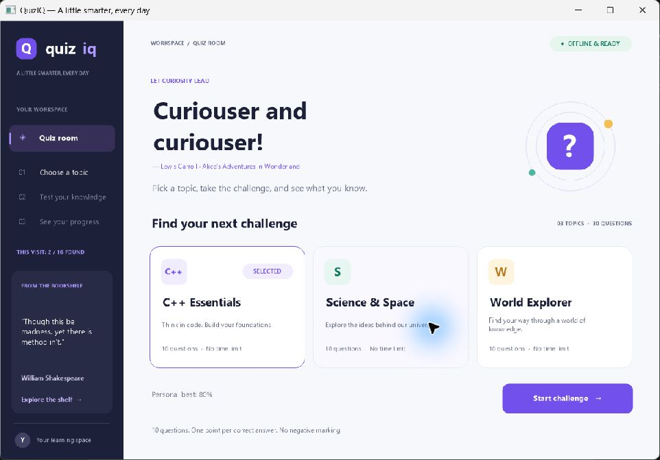
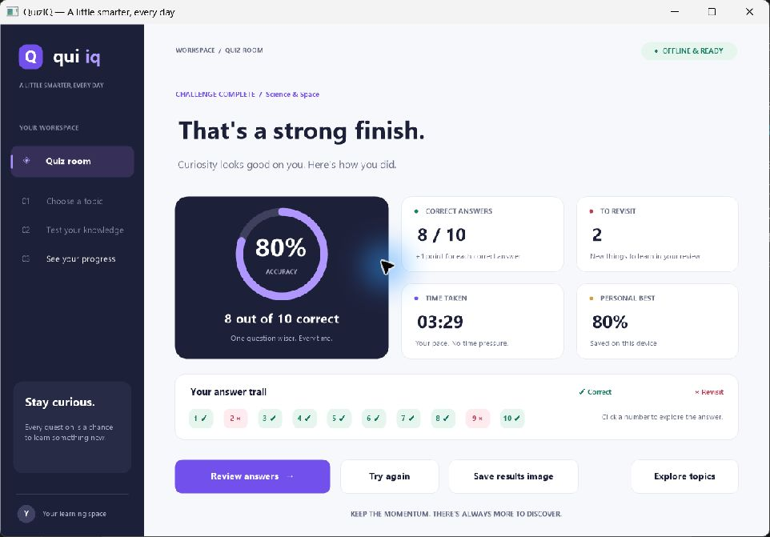
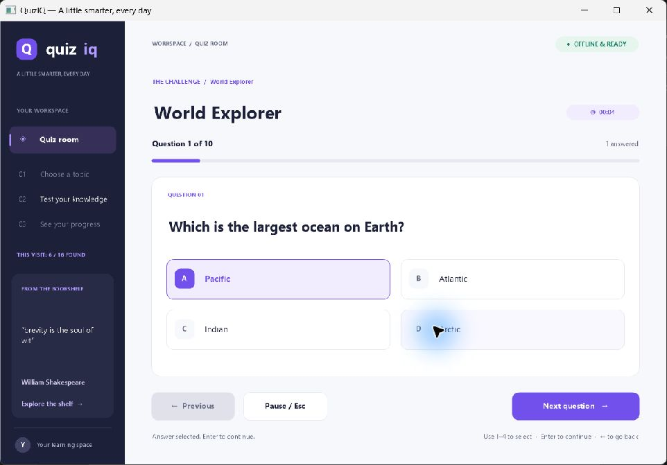
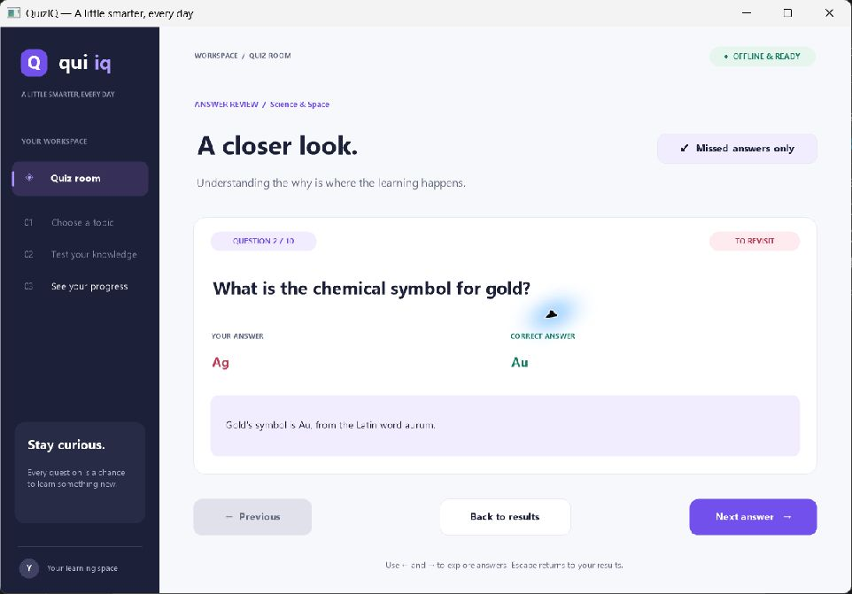
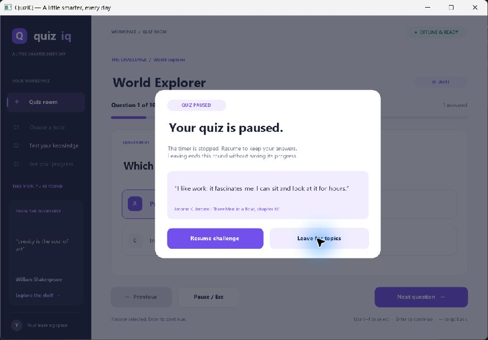
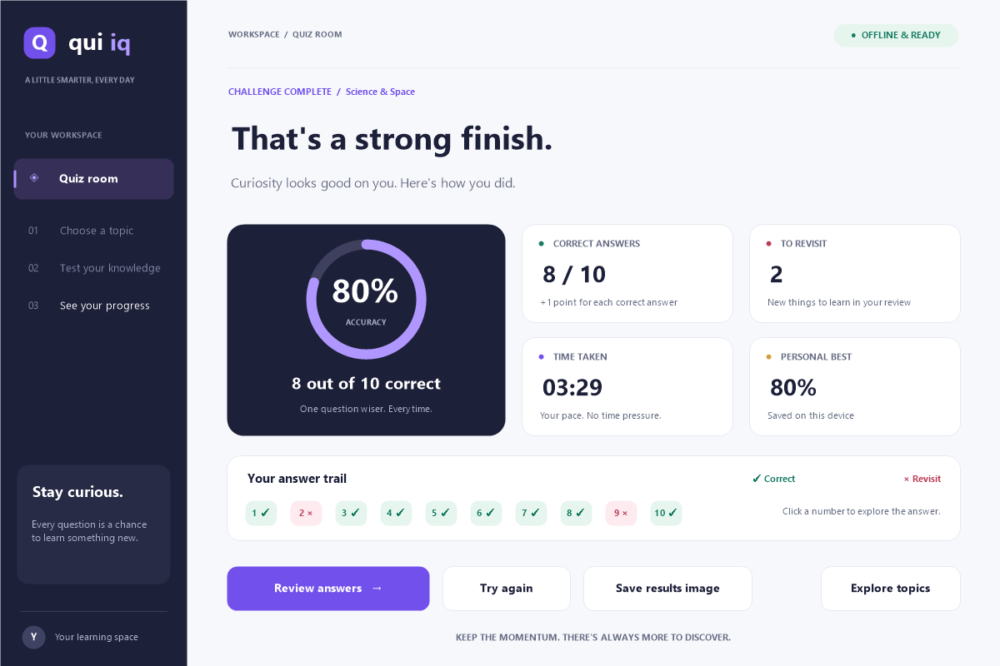
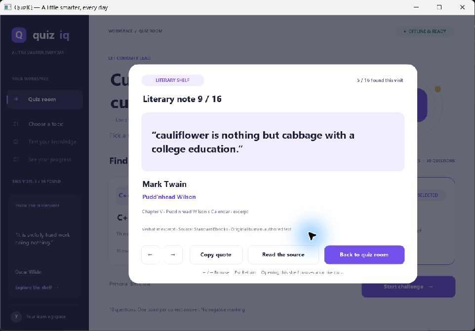

# QuizIQ 1.2 · Literary Edition

A polished, entirely native C++17 quiz application for Windows. A navy sidebar, violet highlights, custom vector cards, and a circular accuracy chart carry a consistent design through topic selection, the quiz, results, and answer review.

**Windows 10/11 · C++17 · Win32/GDI+ · MIT-licensed project code**

[Download the Windows release](https://github.com/harshshodey/quiziq/releases/latest) · [Build and test status](https://github.com/harshshodey/quiziq/actions/workflows/windows.yml) · [Contributing](CONTRIBUTING.md)



## New in the Literary Edition

Sixteen verbatim excerpts by Lewis Carroll, Oscar Wilde, Mark Twain, Jerome K. Jerome, William Shakespeare, and Jane Austen appear throughout the quiz room. Each was checked directly against the original published text in Standard Ebooks, rather than copied from an unattributed quote list or generated as a new joke. Short excerpts retain their original words and capitalization. Fictional dialogue is identified by speaker in the shelf.

- The welcome screen quotes Carroll; the sidebar changes its literary note as you explore topics and questions.
- The question-mark illustration opens the Hatter's riddle. The sidebar opens its current note.
- Press **F1** or select **Explore the shelf** to open the Literary shelf from a normal quiz-room screen.
- Browse all 16 notes with the arrow buttons or Left/Right keys; Escape returns to your previous screen.
- Each note includes author, work, chapter/act, speaker where relevant, and a **Read the source** link.
- **Copy quote** copies the exact excerpt, author, work, location and source URL together.
- Reading the shelf automatically pauses an active quiz. Returning resumes its timer and preserves answers.
- Discovery counts are for the current visit and reset when the application closes. Best quiz scores still persist.
- Pause, results and review also include credited literary excerpts; quiz instructions and explanations remain direct and functional.
- Rendering reuses its back buffer between paints and reallocates only when the window size changes. All quotes are bundled: no network access is needed for the quiz or shelf. Only opening a source link uses the browser.

Full provenance is in `quote-sources.json`; `quote-verification.txt` records the exact-source check. `tools/verify_sources.ps1` can repeat it against the live original texts and confirm the compiled catalog matches. It needs internet access and may fail if a source host is temporarily unavailable; this does not affect the application.

## Run

Download **QuizIQ.exe** or **QuizIQ-Project.zip** from the [latest release](https://github.com/harshshodey/quiziq/releases/latest), or build the application using the instructions below. Double-click **QuizIQ.exe** to play (or `build/Release/QuizIQ.exe` with Visual Studio). Compiled binaries are distributed as release assets and excluded from source control.

Windows 10 or 11, 64-bit is required. No installation, browser, or internet connection is needed for the quiz. The provided MinGW executable links the compiler runtimes statically; Windows supplies GDI+ and the Win32 APIs.

## Included features

- 30 questions across C++ Essentials, Science & Space, and World Explorer.
- Ten questions per round, each with four choices.
- Selection highlighting, progress bar, answered count, and elapsed timer.
- Previous-question navigation with preserved answers; selections can be revised.
- An answer is required to advance. Each correct answer earns one point; there is no penalty for an incorrect answer and no time limit.
- Results show score, percentage accuracy, time, personal best, and a colored answer trail.
- Click any answer-trail number to see your response, the correct response, and an explanation.
- Retry the topic or return to topic selection.
- Pause/resume with Escape, and automatic pause when minimized. Paused time is excluded from the result.
- Closing an active quiz opens an in-app confirmation so a stray close cannot immediately discard your round.
- Filter answer review to missed questions and move directly between the answers to revisit.
- Save your results as a full-resolution 1200 × 800 PNG through a native Save dialog.
- Clear keyboard focus on all controls, including the answer trail; predictable forward and reverse Tab order.
- Darker secondary text and symbol-based correct/incorrect markers improve readability.
- Best accuracy per topic persists in `%LOCALAPPDATA%\QuizIQ\best-scores.txt`. Complete writes replace the old file atomically; damaged files are rejected and save failures are shown on results. A completed 0% score is distinct from an unplayed topic. Legacy score files are supported. In-progress rounds are not persisted; confirmed exit or leaving for topics ends the current round.
- Resizable, proportionally scaled interface with double-buffered painting.

## Controls

| Input | Action |
|---|---|
| Mouse | Select cards, answers, or buttons |
| 1–3 on the welcome screen | Choose a topic |
| 1–4 / numeric keypad 1–4 | Choose an answer during a quiz |
| Enter | Start the selected topic / continue after selecting an answer |
| Left arrow | Previous quiz question |
| Left / Right arrow | Previous / next answer during review |
| Escape during a quiz | Pause / resume |
| Escape during review | Return to results |
| F1 | Open the literary shelf (also pauses an active quiz) |
| Left / Right in the shelf | Previous / next literary note |
| Escape in the shelf | Return and resume an active quiz |
| Tab / Shift+Tab | Move keyboard focus between interactive items |
| Enter / Space | Activate the focused item |

## Build from source

### MinGW-w64

Install a C++17-capable MinGW-w64 compiler, place `g++` on PATH, and run `build.bat` from the project folder. The script also recognizes `C:\msys64\ucrt64\bin`. It builds the app and runs the engine tests.

### CMake (MinGW or Visual Studio)

```sh
cmake -S . -B build
cmake --build build --config Release
ctest --test-dir build -C Release --output-on-failure
```

Windows SDK libraries used: `gdiplus`, `user32`, `gdi32`, `shell32`, `ole32`, `uuid`, and `comdlg32`. Visual Studio requires the Desktop development with C++ workload. The release executable was compiled and verified with MinGW-w64 GCC 15.2.0. The [Windows workflow](https://github.com/harshshodey/quiziq/actions/workflows/windows.yml) builds the CMake/Visual Studio version and runs all three test programs on GitHub's hosted runner.

## Project structure

```text
QuizIQ.exe                Ready-to-run application
src/main.cpp              Native window, vector UI, navigation, timer, persistence
src/quiz_engine.h         Question banks and independent scoring/session model
src/app_model.h           Screen transitions, review filtering, pause-aware timer
src/score_store.h         Validated loading and atomic best-score persistence
src/literary_notes.h      Verified verbatim excerpt catalog used by the app
src/literary_shelf.h      Discovery and literary-note navigation
tests/engine_tests.cpp    Scoring, navigation, timer, storage and stress tests
tests/view_tests.cpp      Actual offscreen native renderer and control layout tests
tests/literary_tests.cpp  Provenance, discovery, wrap and reading-timer tests
quote-sources.json        Every excerpt with author, work, locator and source URL
quote-verification.txt    Verbatim-match record against downloaded primary texts
tools/verify_sources.ps1  Optional live source-verification script
build.bat                 One-command MinGW build and test
CMakeLists.txt            Alternative Windows build
screenshots/              Window captures and a PNG exported from the running app
verification.txt          Test results and manual verification record
```

To add or modify questions, edit `makeTopics()` in `src/quiz_engine.h`. Each question supplies a prompt, four options, a zero-based correct-option index, and an explanation. The interface currently presents ten questions per topic; preserve that count when replacing banks.

## Screenshots

The JPG screenshots are native application captures. The welcome, question, pause and literary-shelf captures show the Literary Edition. The results/review captures and `06-exported-results.png` document the earlier 1.1 verification round: Science & Space, with questions 2 and 9 deliberately incorrect. Score and review behavior are retained; the new edition adds literary notes to those screens too.














## Verification

The Literary Edition passes 133,263 engine/model/storage checks, 96,357 native rendering checks, and 211 literary/discovery tests (229,831 total). All 16 excerpts also matched their downloaded primary texts verbatim. The native renderer checks each full quote fits both the sidebar and shelf at three viewport sizes. Engine checks were previously run in a debug build with standard-library assertions and an optimized NDEBUG build; checks remain active in Release builds.

Coverage includes every score from 0% through 100% in all three topics, every question and option index, revised answers, navigation boundaries, stale actions from another screen, retry resets, pause time exclusion, missed-only review, corrupted/missing/legacy score files, save failures, atomic replacement, and 75,000 deterministic mixed input actions. Render checks cover three viewport sizes and four result levels per topic, checking reachable control bounds, duplicate actions, overlapping interactive areas, focus targets, Tab order, and isolation of the pause dialog.

A complete Science & Space round was played in the real Windows app: results correctly show 8/10 and 80%, and missed-only review jumps from question 2 to question 9. The actual UI was also checked for reverse Tab focus, answer preservation when going back, unanswered-question blocking, keypad entry, pause/resume, close cancellation, PNG export and cancellation, and saved-best reload after restarting. See `verification.txt` for the record. Testing reduces risk but does not prove there can be no defects on every Windows configuration.

This project uses custom-drawn controls. Standard Win32 accessibility semantics are not exposed for individual cards; mouse and documented keyboard controls are supported. Quiz questions are presented in a fixed order for a predictable learning experience.

## Contributing and license

See [CONTRIBUTING.md](CONTRIBUTING.md) for development and pull-request guidance. Original QuizIQ code and project documentation are available under the [MIT license](LICENSE). The included literary excerpts retain their original attribution; see [THIRD_PARTY_NOTICES.md](THIRD_PARTY_NOTICES.md) and [quote-sources.json](quote-sources.json).

The Windows workflow builds and tests new commits and pull requests. Local verification results above describe the tested MinGW build; the hosted workflow reports its own results after the repository is published.
